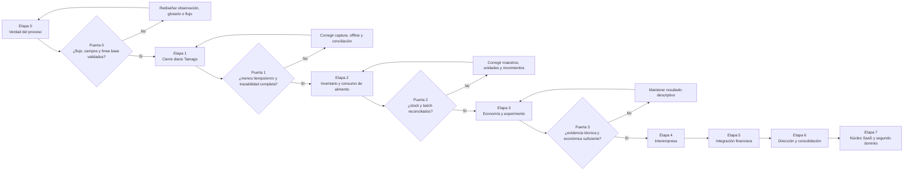

# Handoff UX/UI para Elkin · corte 0.1

## Objetivo del avance

Validar un primer corte vertical antes de diseñar todo el ERP: registrar las tres recogidas de Tamago, clasificar por gramaje, conciliar la diferencia, valorar el resultado y cerrar la jornada con trazabilidad.

## Historia principal

Como galponero, quiero registrar cada recogida con pocos campos, incluso sin conexión, para que bodega y supervisión conozcan la producción sin volver a digitarla.

Como responsable de bodega, quiero clasificar el huevo recibido y ver inmediatamente cualquier diferencia frente a lo recogido, para explicar el inventario antes del cierre.

Como supervisor, quiero cerrar la jornada solamente cuando los controles estén completos, para que los indicadores publicados tengan un estado de confianza visible.

## Pantallas P0

1. Contexto global: empresa, periodo, ubicación y rol.
2. Registro móvil de recogida: lote, turno, cantidad, fecha/hora y responsable.
3. Clasificación: batch, cantidades por tipología, muestra de peso y merma.
4. Conciliación: recogido − clasificado, causa, evidencia y aprobación.
5. Cierre operativo: # Estrategia crítica de producto · etapas 0 y 1

Fecha de corte: 11 de septiembre de 2026  
Responsables iniciales: Heydi Ortiz (producto, UX/UI y finanzas) y Elkin (ingeniería)  
Caso de validación: Tamago, con integración posterior de La Paulina y Transagro

## 1. Decisión principal

El proyecto no debe comenzar como un ERP universal, un sistema contable completo, una plataforma causal y un SaaS multisector al mismo tiempo. La arquitectura puede prever esas capacidades, pero el producto debe demostrar primero un circuito operativo pequeño, frecuente, costoso cuando falla y verificable con evidencia.

El primer producto validable será:

> Registrar las tres recogidas de huevo de Tamago, clasificar el huevo, conciliar diferencias y cerrar el día con responsables, estados y trazabilidad.

Esta elección no reduce la visión. Crea el núcleo reusable: identidad del hecho, tiempo, empresa, lote, cantidad, unidad, responsable, evidencia, estado, corrección y cierre. Después se añaden inventario de alimento, costos, ventas, contabilidad e interempresa.

## 2. Qué demuestra la información existente

El archivo `Registro Diario Multi Líneas v2026.xlsx` contiene nueve hojas de cálculo operativas y siete hojas gráficas. Conserva información importante de lote, levante, producción diaria y semanal, clasificación, curvas de referencia y pesajes.

La inspección estructural encontró:

- 29.663 fórmulas.
- 74 fórmulas con referencias externas y cuatro vínculos externos registrados.
- 6.635 fórmulas que devuelven cero ante determinadas ausencias o condiciones.
- Un registro diario de producción con fecha, edad, consumo, mortalidad, selección, venta, producción total, saldo de aves, observaciones, consumo por ave y saldo de alimento.
- Una clasificación diaria por Yumbo, AAA, AA, A, B, C, sucio, roto y yema.
- Cálculos semanales y comparación contra curvas por línea genética.

Esto significa que el archivo ya es una especificación parcial del dominio. También muestra por qué no conviene copiarlo pantalla por pantalla:

- El dato capturado, el cálculo y el reporte están acoplados.
- La producción diaria aparece como un total; las tres recogidas no son hechos independientes.
- No existe un identificador inmutable por evento ni una corrección compensatoria.
- Un cero puede significar “no ocurrió”, “no se registró”, “no aplica” o “no pudo calcularse”.
- Fabricante, fórmula, lote físico del alimento, transición y costo puesto en granja no forman una cadena analítica completa.
- La trazabilidad comercial, contable e interempresa no vive en el mismo modelo.

La migración debe extraer conocimiento y datos; no debe reproducir la estructura del libro.

## 3. Matriz DOFA orientada a decisiones

### Fortalezas

| Fortaleza | Valor real | Cómo explotarla |
|---|---|---|
| Acceso directo a las tres empresas | Se pueden observar procesos y validar sin depender de un cliente externo | Ejecutar pilotos con datos y usuarios reales cada semana |
| Heydi combina UX/UI y finanzas | Puede conectar lenguaje operativo, decisión económica y visualización | Diseñar cada pantalla desde la decisión, la evidencia y el asiento potencial |
| Elkin aporta desarrollo | Existe una pareja producto–ingeniería desde el inicio | Aprobar juntos contratos de eventos y criterios de aceptación antes de código |
| La hoja existente codifica años de práctica | Contiene campos, curvas, fórmulas y categorías útiles | Convertirla en inventario de reglas; no en arquitectura de base de datos |
| El grupo tiene flujos PAU–TAM–TRA | El caso multiempresa es real, no hipotético | Validar matching y consolidación después del cierre operativo básico |
| Problema frecuente y cuantificable | El registro ocurre todos los días y los errores tienen costo | Medir tiempo, completitud, diferencias y reprocesos antes/después |

### Debilidades

| Debilidad | Efecto | Respuesta |
|---|---|---|
| Alcance simultáneo demasiado amplio | Aumenta tiempo, costo y probabilidad de no terminar nada utilizable | Separar arquitectura futura de alcance comprometido por etapa |
| No hay línea base formal | No se puede demostrar que el software mejoró la operación | Medir durante cinco días tiempo de captura, retrabajo, faltantes y cierres |
| Reglas mezcladas con celdas y reportes | Es difícil versionar, probar y explicar resultados | Crear contratos de métricas con fórmula, población, unidad, estado y versión |
| La calidad histórica no está clasificada | Un tablero puede presentar falsa precisión | Asignar nivel de confianza por fuente, periodo y campo |
| No están cerradas políticas contables clave | El sistema puede confundir gestión con libro legal | Mantener integración contable como etapa separada y exigir validación profesional |
| Equipo inicial de dos personas | Hay riesgo de sobrecarga y sesgo de confirmación | Definir responsables consultados: operador, supervisor, contador y veterinario/zootecnista |
| UX todavía no fue observada en contexto | Los formularios pueden parecer fáciles en escritorio y fallar en galpón | Probar prototipos con ruido, guantes, poca señal y tiempo limitado |

### Oportunidades

| Oportunidad | Resultado posible | Condición |
|---|---|---|
| Cierre diario confiable | Menos recaptura y diferencias explicadas el mismo día | Eventos simples, trabajo offline, validación y aprobación |
| Trazabilidad alimento–lote–huevo | Comparar contribución por proveedor y fórmula | Registrar batch, transición, consumo y variables de confusión |
| Negociación con proveedores | Comprar por margen esperado y no solo por precio del bulto | Ensayo comparable y costo puesto en granja |
| Matching interempresa | Cierres más rápidos sin borrar autonomía legal | Documento bilateral y reglas de eliminación |
| Explicaciones gerenciales | Saber por qué cambió margen, caja o inventario | Árboles de drivers con drill-down hasta eventos |
| Núcleo horizontal futuro | Aplicar eventos, ledger y métricas a otros sectores | Extraerlo solo después de validar dos dominios distintos |
| IA supervisada | Detectar anomalías y proponer preguntas útiles | Datos suficientes, estados explícitos y explicación verificable |

### Amenazas

| Amenaza | Daño potencial | Control preventivo |
|---|---|---|
| Inferir causalidad de una correlación | Comprar alimento más caro por una conclusión falsa | Diseños por bloques/crossover, periodo de adaptación y control de covariables |
| Rechazo del personal y Excel paralelo | Datos incompletos y doble fuente de verdad | Co-diseño, captura más rápida que el método actual y calendario de transición |
| Fuga de datos entre empresas | Riesgo legal, competitivo y reputacional | Permisos por tenant, empresa, ubicación, periodo y acción; pruebas de aislamiento |
| Automatizar contabilidad sin política aprobada | Estados incorrectos y cierres no auditables | Integrar primero; no sustituir el libro legal en el MVP |
| Mala conectividad | Duplicados, pérdida de hechos o demora | Cola offline, `local_event_id`, idempotencia y resolución de conflictos |
| Generalización prematura | Producto abstracto que no resuelve bien ningún sector | Avicultura primero; segundo sector como prueba posterior del núcleo |
| Dependencia de una fórmula opaca | Decisiones no explicables y difícil auditoría | Versionar reglas, conservar inputs y mostrar trazabilidad |
| Crecimiento del soporte | El equipo queda atrapado resolviendo datos y usuarios | Observabilidad, manuales cortos, administración de catálogos y límites de SLA |

## 4. Diagnóstico sin suavizar

### En qué está fallando hoy el enfoque

1. **Se está diseñando desde la totalidad de la empresa y no desde un momento de trabajo.** La visión integra todo, pero un usuario no “registra la empresa”; registra una recogida, una clasificación o una recepción.
2. **Se confunden cuatro productos.** Registro operativo, ERP contable, inteligencia gerencial y laboratorio causal necesitan ritmos, controles y especialistas distintos.
3. **Se quieren definir indicadores antes de asegurar sus denominadores.** Sin aves-día, kg realmente consumidos, transición y huevo vendible, una razón elegante puede ser falsa.
4. **Se trata el tiempo real como velocidad.** Un dato rápido pero no conciliado debe verse como preliminar. Tiempo real significa conocer también su estado y frescura.
5. **Se corre el riesgo de copiar Excel.** La hoja es fuente de reglas; sus celdas, duplicaciones y ceros defensivos no son un buen modelo de eventos.
6. **El ejemplo Solla vs. Hacienda todavía es una hipótesis observacional.** “Produjo más Yumbo” no demuestra que el alimento fue la causa si cambiaron edad, clima, agua, salud, luz, genética o manejo.
7. **No existe una definición única de éxito del MVP.** “Tener dashboard” no es éxito. Reducir tiempo, faltantes, diferencias y reproceso sí puede medirse.
8. **No se han escrito criterios de descarte.** Si una etapa no mejora la operación, debe detenerse o rediseñarse antes de ampliar alcance.
9. **La contabilidad parece una extensión de indicadores.** Requiere políticas, doble partida, cierres, documentos, impuestos y aprobación profesional independiente.
10. **La idea de SaaS horizontal llega demasiado pronto.** La generalización correcta se descubre comparando implementaciones reales, no reemplazando “huevo” por “producto”.

### Lo que todavía no se está pensando con suficiente profundidad

- Quién compra el SaaS, quién decide renovarlo y cuál problema justifica el precio.
- Propiedad y administración de catálogos maestros: lote, empresa, galpón, unidad, proveedor y fórmula.
- Incentivos del operador para registrar bien y consecuencias de un dato incompleto.
- Operación sin red, batería baja, dispositivo compartido y conflicto entre dos capturas.
- Recuperación ante pérdida, copias de seguridad, RPO, RTO y exportación de datos.
- Separación y retención de datos entre entidades legales y tenants.
- Trazabilidad de consentimiento, fotos, documentos y datos personales.
- Versiones de curvas genéticas, listas de precios, reglas contables y fórmulas.
- Costo de implementación, soporte, capacitación, dispositivos y saneamiento de historia.
- Calendario real de cierres: operativo, inventario, contable e interempresa.
- Bienestar animal y aprobación técnica de experimentos de alimentación.
- Qué decisiones nunca debe tomar automáticamente el sistema.
- Qué pasa cuando dos fuentes legítimas discrepan.
- Cómo se medirá adopción después de la novedad inicial.

## 5. Principios de solución

1. **Un hecho se registra una vez.** Las lecturas operativa, de inventario, financiera e interempresa se derivan.
2. **Un cero nunca sustituye una ausencia.** Usar estados: valor, faltante, no aplica, estimado, observado, conciliado, contabilizado y cerrado.
3. **Cada cifra tiene contrato.** Nombre, propósito, fórmula, numerador, denominador, unidad, periodo, dimensiones, fuente, versión, control y responsable.
4. **Corrección sin borrado.** Un evento nuevo compensa o sustituye lógicamente al anterior.
5. **La pantalla empieza con una tarea.** Mostrar contexto heredado y pedir solo lo que el operador conoce en ese momento.
6. **Profundidad progresiva.** Operador ve acción; supervisor ve excepción; dirección ve resultado; auditor llega al soporte.
7. **Estado visible.** Un valor preliminar no puede parecer cerrado.
8. **Arquitectura preparada, alcance limitado.** Diseñar IDs y permisos multiempresa desde el principio; construir solo el vertical slice aprobado.
9. **Toda etapa termina en evidencia.** No avanzar por calendario sino por criterios de salida.
10. **Automatización después de comprensión.** Primero explicar y validar la regla; luego automatizarla.

## 6. Hoja de ruta con puertas de decisión

Los tiempos son rangos iniciales. Se revisan al terminar la etapa 0.

### Etapa 0 · Verdad del proceso (10 días hábiles)

**Objetivo:** acordar qué sucede hoy, quién lo hace, qué significa cada dato y cuánto cuesta el problema.

**Entregables de Heydi:**

- Mapa de actores y permisos.
- Service blueprint del día de producción.
- Inventario de decisiones P0.
- Diccionario de 15–20 campos del primer flujo.
- Línea base de tiempo, omisiones, correcciones y cierre.
- Prototipo de baja fidelidad probado con tres roles.
- Registro de decisiones y dudas abiertas.

**Entregables de Elkin:**

- Propuesta de contrato de eventos.
- Spike offline/idempotencia.
- modelo mínimo de permisos.
- estrategia de ambientes, copias y observabilidad.

**Puerta 0 — avanzar solo si:**

- Operador, bodega y supervisor pueden recorrer el flujo sin explicación del diseñador.
- Cada campo tiene dueño, unidad y momento de captura.
- Se conoce la línea base de cinco jornadas reales.
- Contador y responsable técnico identifican qué datos son operativos y cuáles requieren validación profesional.
- No quedan dos significados incompatibles para recogida, clasificado, merma o cierre.

**No construir aún:** contabilidad completa, IA, consolidación, nómina, activos, portal externo ni personalización multisector.

### Etapa 1 · Cierre diario de Tamago (3–4 semanas)

**Circuito:** `recogida 1/2/3 → entrega a bodega → clasificación → diferencia → aprobación → cierre`.

**Eventos mínimos:**

- `EggCollectionRecorded`
- `EggCollectionTransferred`
- `EggBatchClassified`
- `EggDifferenceExplained`
- `OperationalDayClosed`
- `OperationalEventCorrected`

**Pruebas propuestas para el piloto:**

- Catorce días consecutivos con las tres recogidas esperadas o una excepción explicada.
- Cero duplicados tras sincronización.
- Cero correcciones que borren el hecho original.
- Toda diferencia de cierre tiene causa, responsable y estado.
- La mediana de captura de una recogida es inferior al tiempo de línea base. El equipo fijará el umbral después de medirla.
- Supervisor puede reconstruir un total diario desde los eventos sin consultar otra hoja.

**Puerta 1:** si el sistema no reduce tiempo o error frente al método actual, se rediseña el flujo antes de añadir módulos.

### Etapa 2 · Inventario y consumo de alimento (3 semanas)

**Circuito:** `orden/compra → viaje → recepción → batch → almacenamiento → consumo por lote → conteo → diferencia`.

**Datos decisivos:** fabricante, producto, fórmula/versión, lote de proveedor, fecha, bultos, kg por bulto, kg recibidos, costo neto, flete, descuentos, costo puesto en granja, bodega, lote avícola, kg consumidos y transición.

**Puerta 2:** todo consumo del piloto se asocia a un batch y la ecuación de stock se reconcilia dentro de una tolerancia explícita aprobada. La tolerancia no debe codificarse hasta que operación la defina.

### Etapa 3 · Economía del alimento y experimento (4–8 semanas de datos)

**Primera salida descriptiva:**

```text
ingreso_neto_huevo = Σ(huevos_vendibles_clase × precio_neto_clase)
contribución_observada = ingreso_neto_huevo − costo_alimento − otros_costos_incrementales
contribución_por_ave_día = contribución_observada / aves_día
contribución_por_kg_alimento = contribución_observada / kg_alimento_consumido
```

**Efecto comparativo si existe diseño válido:**

```text
efecto_DiD = (resultado_tratamiento_post − resultado_tratamiento_pre)
           − (resultado_control_post − resultado_control_pre)
```

Debe definirse antes del ensayo qué representa `resultado`: masa vendible por ave-día, margen por ave-día o margen por kg, además del periodo de adaptación y las covariables.

**Puerta 3:** el veterinario/zootecnista aprueba protocolo y bienestar; los grupos son comparables; la muestra alcanza el criterio acordado; y el resultado se etiqueta como descriptivo, estimado o causal según la evidencia.

### Etapa 4 · Operaciones interempresa (3–4 semanas)

**Circuitos iniciales:** PAU transfiere aves a TAM; TRA presta transporte a PAU/TAM.

**Puerta 4:** los dos lados conservan documentos propios, el expediente común concilia cantidades/valores/fechas y el grupo elimina sin alterar los libros individuales.

### Etapa 5 · Integración financiera (4–6 semanas)

**Alcance:** ventas, cartera, recaudo, compras, proveedores, inventarios valorizados y enlace con el sistema contable legal.

**Puerta 5:** submayores operativos reconcilian con balanza de prueba del periodo; las diferencias quedan explicadas; el sistema no presenta una cifra gerencial como legal.

### Etapa 6 · Dirección y consolidación (4 semanas)

**Alcance:** margen por empresa, capital de trabajo, caja, interempresa, eliminación, drivers y drill-down.

**Puerta 6:** cada KPI baja hasta hechos/documentos, muestra estado/frescura y conserva la reconciliación de cada empresa.

### Etapa 7 · Núcleo SaaS y segundo dominio

Solo aquí se extraen componentes horizontales y se prueba otra empresa o finanzas personales. El segundo dominio debe demostrar qué es verdaderamente común: eventos, documentos, ledger, permisos, métricas y cierres.

### Modelo Mermaid de la secuencia



## 7. Tu parte: trabajo de UX, producto y finanzas

### Esta semana

1. Observar una jornada completa sin proponer pantallas durante la observación.
2. Medir cada punto de captura y recaptura.
3. Entrevistar por separado a operador, bodega y supervisor.
4. Dibujar el blueprint actual y marcar esperas, errores, cambios de medio y decisiones.
5. Definir el glosario P0 con ejemplos y contraejemplos.
6. Bocetar cinco estados: vacío, captura válida, captura incompleta, diferencia y cerrado.
7. Probar el flujo con datos reales anonimizados.
8. Registrar cada decisión con fecha, dueño, evidencia y condición de revisión.

### Artefactos que debes entregar a Elkin

- Flujo actual y flujo propuesto.
- Historia de usuario por tarea, no por módulo.
- Campos obligatorios, heredados, calculados y opcionales.
- Matriz de estados y transiciones.
- Reglas y mensajes de error en lenguaje humano.
- Ejemplos válidos, límites, duplicados y correcciones.
- Criterios de aceptación observables.
- Prototipo con anotaciones y orden de tabulación.
- Lista de eventos analíticos para medir adopción.
- Preguntas abiertas que requieren contador o técnico avícola.

### Repartición de responsabilidades

| Tema | Heydi | Elkin | Consultado | Aprobación final |
|---|---|---|---|---|
| Problema y prioridad | Responsable | Consultado | Operación | Product owner |
| Flujo y contenido UX | Responsable | Consultado | Usuarios | Heydi |
| Definición financiera | Responsable | Consultado | Contador | Responsable financiero |
| Fórmula productiva | Coautora | Implementa | Veterinario/zootecnista | Responsable técnico |
| Contrato de evento | Coautora | Responsable | Operación | Ambos |
| API, sincronización y seguridad | Consultada | Responsable | Seguridad/infraestructura | Elkin |
| Pruebas de aceptación | Responsable | Automatiza | Usuarios | Ambos |
| Política contable | Consultada | Implementa integración | Contador/revisor | Responsable contable |

## 8. Backlog P0 para empezar

| ID | Historia | Evidencia de aceptación | Dueño | Dependencia |
|---|---|---|---|---|
| UX-001 | Como operador identifico empresa, granja, lote y turno sin reescribirlos | El contexto correcto persiste y se puede verificar antes de guardar | Heydi/Elkin | Catálogos |
| UX-002 | Como operador registro una recogida en pocos pasos | Prueba cronometrada frente a línea base | Heydi | Observación |
| UX-003 | Como operador trabajo sin conexión | Evento queda pendiente y visible | Elkin | Spike offline |
| UX-004 | Como sistema evito duplicar una sincronización | Mismo `local_event_id` produce un solo hecho | Elkin | Contrato |
| UX-005 | Como bodega recibo una entrega vinculada a sus recogidas | Se conserva origen, cantidad, hora y responsables | Ambos | UX-001 |
| UX-006 | Como bodega clasifico por categorías configuradas | Suma de clases visible y validada | Heydi | Catálogo de clase |
| UX-007 | Como supervisor veo la diferencia sin ajustes silenciosos | Diferencia = recogido − clasificado y exige causa según tolerancia | Ambos | Política de tolerancia |
| UX-008 | Como supervisor cierro solo si están los controles | Bloqueos enumeran exactamente qué falta | Heydi/Elkin | Matriz de estados |
| UX-009 | Como usuario corrijo sin borrar | Se crea evento compensatorio con referencia al original | Elkin | Auditoría |
| UX-010 | Como dirección veo el día y su confianza | Total, estado, frescura y excepciones son visibles | Heydi | Eventos completos |
| UX-011 | Como product owner mido adopción | Tiempo, abandono, corrección y trabajo offline quedan instrumentados | Ambos | Analítica de producto |
| UX-012 | Como auditor reconstruyo un total | Drill-down llega hasta eventos y responsables | Elkin | IDs y permisos |

## 9. Métricas de producto de la etapa 1

No usar estas métricas como objetivos definitivos hasta medir la línea base.

- Tiempo mediano para registrar una recogida.
- Porcentaje de recogidas registradas dentro del intervalo acordado.
- Jornadas con tres recogidas completas.
- Eventos duplicados bloqueados.
- Correcciones por 100 eventos.
- Diferencias sin causa al cierre.
- Tiempo desde última recogida hasta cierre operativo.
- Usuarios que completan el flujo sin ayuda.
- Días con Excel paralelo después de la fecha de transición.
- Incidentes de sincronización y tiempo de recuperación.

## 10. Agenda de diez sesiones de trabajo

| Sesión | Tema | Salida obligatoria |
|---|---|---|
| 1 | Alcance y decisión P0 | Una frase de problema, usuario y evidencia |
| 2 | Observación en campo | Línea de tiempo y fricciones reales |
| 3 | Glosario y fuentes | Diccionario sin ambigüedades |
| 4 | Blueprint actual | Personas, pasos, medios, esperas y fallos |
| 5 | Flujo propuesto | Camino principal y excepciones |
| 6 | Contrato de eventos | Payload, estados, idempotencia y corrección |
| 7 | Wireframes | Cinco pantallas y estados límite |
| 8 | Prueba con usuarios | Hallazgos priorizados por severidad |
| 9 | Refinamiento técnico | Historias listas y dependencias explícitas |
| 10 | Revisión de puerta 0 | Avanzar, rediseñar o detener con evidencia |

## 11. Prompts de trabajo

### Prompt 1 · Observación del proceso

```text
Actúa como investigador de operaciones y UX. Analiza estas notas de observación de [rol] durante [proceso]. No diseñes pantallas todavía. Devuelve: 1) secuencia cronológica, 2) objetivo de cada paso, 3) entradas y salidas, 4) decisiones, 5) esperas, 6) recapturas, 7) errores y recuperaciones, 8) datos que el usuario conoce en ese momento, 9) datos que el sistema podría heredar, 10) preguntas pendientes. Distingue hecho observado, interpretación e hipótesis. Si falta evidencia, escribe “no determinado”. Notas: [PEGAR NOTAS].
```

### Prompt 2 · Entrevista sin inducir respuestas

```text
Diseña una entrevista de 30 minutos para [rol] sobre [tarea]. Evita preguntas sobre funcionalidades deseadas. Prioriza episodios recientes: última vez, pasos, excepciones, herramientas, presión de tiempo, consecuencias del error y forma de comprobar que terminó bien. Incluye preguntas de seguimiento y una tabla para registrar cita/paráfrasis, evidencia, frecuencia, impacto y confianza. Objetivo de decisión: [DECISIÓN].
```

### Prompt 3 · Historia lista para desarrollo

```text
Convierte este flujo UX en una historia implementable. Incluye: actor, intención, valor, precondiciones, camino principal, excepciones, campos obligatorios/heredados/calculados, estados, permisos, reglas, mensajes de error, eventos analíticos, criterios Given/When/Then y fuera de alcance. No inventes reglas. Marca [REQUIERE DECISIÓN] cuando falte dueño, unidad, tolerancia o política. Flujo: [PEGAR FLUJO].
```

### Prompt 4 · Contrato de evento para Elkin

```text
Actúa como arquitecto de datos event-driven. A partir de esta historia [HISTORIA], propón el contrato JSON de [EVENTO]. Separa encabezado canónico y payload tipado. Incluye tenant_id, company_id, site_id, lot_id, business_date, occurred_at, recorded_at, recorded_by, local_event_id, idempotency_key, status, version y supersedes_event_id cuando aplique. Define validaciones, claves de unicidad, transiciones permitidas, permisos y ejemplos válido/inválido. No conviertas ausencia en cero. Señala decisiones de negocio no resueltas.
```

### Prompt 5 · Contrato de ecuación

```text
Formaliza la métrica [NOMBRE] para software. Devuelve: pregunta que responde, fórmula simbólica, numerador, denominador, población, grano, periodo, unidades, dimensiones, inclusiones, exclusiones, fuente de cada variable, manejo de cero/faltante/no aplica, redondeo, versión, responsable, estado mínimo del dato, reconciliación, ejemplo numérico, casos límite y pruebas. Rechaza la fórmula si mezcla poblaciones o periodos incompatibles. Contexto: [CONTEXTO].
```

### Prompt 6 · Revisión UX crítica

```text
Revisa este wireframe como operador de campo, responsable de bodega, supervisor y auditor. Para cada rol identifica: información sobrante, información faltante, riesgo de toque equivocado, carga cognitiva, legibilidad, trabajo sin red, recuperación de error, estado incierto, permisos y evidencia. Prioriza P0/P1/P2. No evalúes estética hasta verificar que la tarea puede terminarse. Wireframe y flujo: [ADJUNTAR].
```

### Prompt 7 · Pruebas de frontera

```text
Genera pruebas Given/When/Then para [HISTORIA/EVENTO]. Incluye valor válido, cero válido, campo faltante, negativo, unidad incompatible, duplicado, evento tardío, periodo cerrado, usuario sin permiso, sincronización repetida, dos dispositivos, corrección, reapertura y cambio de versión de regla. Para cada prueba indica estado esperado, mensaje al usuario y efecto en inventario/KPI/auditoría.
```

### Prompt 8 · Protocolo de comparación de alimento

```text
Actúa como equipo compuesto por zootecnista avícola, estadístico causal y controller. Diseña un protocolo para comparar [ALIMENTO A] y [ALIMENTO B] sin confundir correlación con causalidad. Define unidad experimental, asignación o crossover, periodo de adaptación, duración, tamaño de muestra o análisis de potencia, resultado primario, resultados secundarios, aves-día, consumo real, masa y clases de huevo, precios netos, costos incrementales, clima, agua, luz, salud, genética, manejo, mortalidad, criterios de exclusión, bienestar animal y plan de análisis. Separa salida descriptiva, inferencia ajustada y recomendación económica. Marca todo supuesto no validado.
```

### Prompt 9 · Revisión contable

```text
Actúa como contador/controller revisor. Evalúa este flujo [FLUJO] y sus eventos [EVENTOS]. Separa: hecho operativo, documento legal, submayor, asiento propuesto, aprobación, conciliación y cierre. Identifica políticas que requieren decisión profesional, impuestos por jurisdicción, tratamiento interempresa, utilidad no realizada y diferencias entre valor gerencial y contable. No inventes cuentas ni tasas. Devuelve bloqueadores antes de contabilizar automáticamente.
```

### Prompt 10 · Revisión de sprint con puerta

```text
Evalúa el sprint [NÚMERO] contra esta puerta de decisión [CRITERIOS]. Usa únicamente evidencia adjunta. Para cada criterio responde demostrado/no demostrado/parcial, cita la evidencia, explica el riesgo y propone la prueba mínima siguiente. Termina con una sola recomendación: avanzar, rediseñar o detener. No uses porcentaje de avance ni cantidad de pantallas como sustituto de valor operativo.
```

## 12. Regla para las reuniones Heydi–Elkin

Cada conversación sobre una función debe terminar con seis respuestas:

1. ¿Qué decisión o tarea mejora?
2. ¿Quién la ejecuta y en qué contexto?
3. ¿Qué hecho se captura y cuál se deriva?
4. ¿Qué puede fallar y cómo se recupera?
5. ¿Qué prueba demuestra que funciona?
6. ¿Qué queda explícitamente fuera de esta etapa?

Si alguna respuesta falta, la historia todavía no está lista para desarrollo.
, bloqueos, firma y versión.
6. Panorama diario: postura, huevos, masa, consumo, inventario y alertas.

## Contrato mínimo del evento

```json
{
  "event_id": "uuid del servidor",
  "local_event_id": "uuid del dispositivo",
  "tenant_id": "tam",
  "company_id": "tamago",
  "business_date": "2026-09-06",
  "occurred_at": "2026-09-06T11:32:00-05:00",
  "recorded_at": "2026-09-06T11:35:12-05:00",
  "recorded_by": "user_id",
  "event_type": "EggCollectionRecorded",
  "lot_id": "T-2604",
  "collection_no": 2,
  "quantity": 17860,
  "unit": "egg",
  "status": "captured",
  "version": 1
}
```

## Reglas de aceptación

- `local_event_id` hace la sincronización idempotente.
- No puede existir más de una recogida activa para el mismo lote, fecha y número sin excepción aprobada.
- La cantidad nunca es negativa y la unidad es explícita.
- Un periodo cerrado no recibe eventos sin reapertura autorizada.
- La diferencia de clasificación no crea un ajuste silencioso.
- Un cierre guarda quién aprobó, cuándo y con qué versión de reglas.
- Una corrección crea un nuevo evento compensatorio; no borra el original.

## Estados visibles

`captured → validated → observed/reconciled → posted → closed`

Los estados estimado, experimental y preliminar no pueden compartir tratamiento visual con cerrado.

## Acuerdo de trabajo

Heydi define problema, flujo, lenguaje, fórmula, prioridad y prueba con usuarios. Elkin define esquema, API, sincronización, seguridad, auditoría y pruebas automatizadas. Ambos aprueban el contrato del evento y la definición de terminado antes de ampliar el alcance.

## Fuera del primer sprint

- Sustituir el libro contable legal.
- Consolidación financiera completa.
- Modelos causales automáticos para alimento.
- Inventarios y activos de todas las categorías.
- Portal para clientes o proveedores.

## Secuencia acordada por puertas

1. Etapa 0: observar, medir línea base, cerrar glosario y probar wireframes.
2. Etapa 1: recorrido completo de Tamago desde las tres recogidas hasta el cierre.
3. Etapa 2: recepción, batch, consumo y conciliación de alimento.
4. Etapa 3: comparación económica y experimental de alimento.
5. Etapa 4: expedientes PAU–TAM y TRA–PAU/TAM.
6. Etapa 5: integración con el libro legal y conciliación financiera.

No se empieza una etapa porque terminó el calendario. Se empieza cuando la puerta anterior tiene evidencia.

## Antes de escribir una historia

Heydi y Elkin deben poder responder:

1. Qué decisión o tarea mejora.
2. Quién la realiza y bajo qué contexto.
3. Qué dato captura el usuario y cuál deriva el sistema.
4. Qué ocurre con falta de red, duplicado, evento tardío y corrección.
5. Qué prueba observable demuestra que funciona.
6. Qué queda fuera de alcance.

El análisis completo, la matriz DOFA, las puertas, el backlog y la biblioteca de prompts están en `ESTRATEGIA_PRODUCTO_ETAPAS_0_1.md`. Las decisiones y pruebas deben documentarse en `REGISTRO_DECISIONES_Y_VALIDACION.md`.
