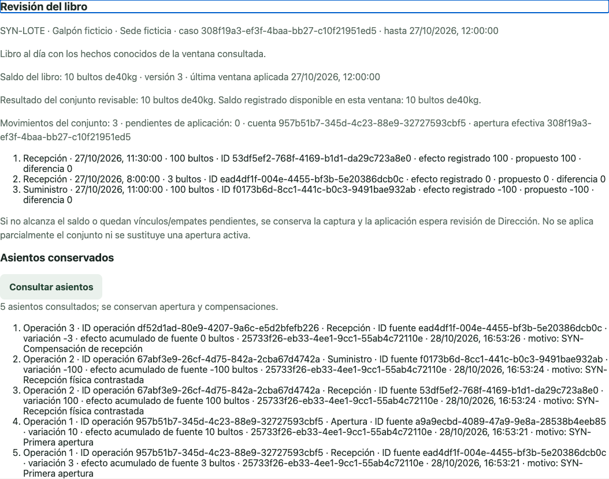

# SaaS operativo · checkpoint técnico demostrable

Código experimental para los flujos de Tamago, La Paulina y Transagro. Esta rama conserva una versión revisable del desarrollo local; **no es una aplicación desplegada ni una aprobación para producción**.

La demostración preparada cubre alimento: conteo aprobado, primera apertura explícita, suministro, vínculo de producto/ubicación, aplicación al libro, insuficiencia, compensaciones y conflicto entre pestañas. Todo usa identidades y datos ficticios con Auth/Postgres locales. Las interfaces de recogidas, custodia y clasificación también están incluidas en el código; no todas están preconfiguradas en el caso de demostración.

## Ejecutar localmente

Requiere Node/pnpm de `.node-version`/`package.json` y Docker en ejecución. Primera instalación y descarga de imágenes necesitan internet.

```sh
pnpm install --frozen-lockfile --ignore-scripts
pnpm demo:start
```

Abre **la URL que imprime la terminal**, terminada en `/demo/`, en ese mismo ordenador. Allí encontrarás cuentas ficticias por rol, botones para copiar y el ID de apertura. **Ctrl+C** cierra la sesión de demostración y retira sus fixtures. La base usa un proyecto Docker exclusivo y conserva sus volúmenes; no borra bases de otros proyectos.

[Guion de demostración y recuperación](docs/DEMO.md) · [Estado y evidencia](docs/ESTADO_TECNICO.md) · [Guía de revisión del código](docs/REVISION.md)

## Qué significa cada estado

- Guardado local y pendiente de envío pertenecen a la captura offline de recogidas, que tiene su propio contrato.
- Recibido por servidor conserva un hecho; no lo aprueba ni lo aplica automáticamente al inventario.
- El libro de alimento solo cambia con una acción explícita y autorizada de Dirección.
- Un resultado revisable negativo bloquea aplicación y conserva la captura original.
- Alimento, custodia y clasificación de este checkpoint requieren conexión. No atribuirles la cola offline de recogidas.

## Verificar

```sh
pnpm test
pnpm lint
TAMAGO_BROWSER_CHANNEL=chrome pnpm test:browser
```

Las pruebas de integración con Postgres requieren **opt-in y entorno local ficticio**. Sin ellos se omiten expresamente; un resultado omitido no acredita ese recorrido. Ver comandos completos y resultados reales en [estado técnico](docs/ESTADO_TECNICO.md).

## Evidencia visual

Captura de navegador automatizado con datos ficticios; no representa un despliegue ni una captura del iPhone físico:



La validación física en iPhone fue comunicada por el usuario y contrastada con registros del servidor local. Sus límites están documentados.

Esta entrega depende del [PR #2 de DEV-002](https://github.com/monicongocreativo-lab/SAAS/pull/2); el nuevo PR es borrador y no integra a `main`. GitHub Pages continúa mostrando su versión anterior. No se añade workflow de despliegue.
